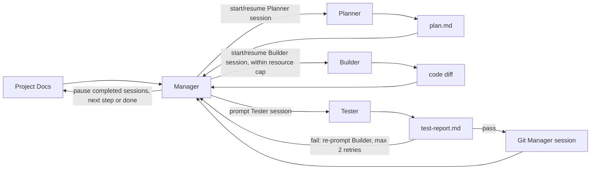

# Alpha-Zeta Dev Force — Core Specification (Seed Doc v0.2)

> **Purpose of this document:** This is a *locked-decision seed spec*, not the full documentation. It is written to be expanded by another AI into complete project documentation for parallel coding agents to implement from. Every decision marked **LOCKED** is a fixed constraint — do not re-derive or contradict it. Every item marked **OPEN** is intentionally left for the next stage to define.
>
> **This spec covers two things, both required in advance:**
> - **Final Product Architecture** — the real target, with persistent interactive CLI agents each running in their own terminal.
> - **V1 Demo Milestone** — a smaller, faster-to-build first step used to validate the Manager's decision logic and artifact handoffs before tackling the harder parts of the final architecture. V1 is optional to build first, but its documentation is produced regardless.

---

## 1. Product Summary

Alpha-Zeta Dev Force is a **Manager-orchestrated AI development platform**. Given a project's documentation, a single long-lived **Manager Agent** keeps a set of **Worker Agents** — Planner, Builder, Tester, and any user-defined role (e.g. Git Manager) — running, and pauses/resumes/prompts each one exactly when needed. Workers are real, interactive coding CLI agents (Claude Code, OpenCode CLI, Gemini/Antigravity CLI, etc.), each visible in its own terminal, running under the platform's control. The human's role is reduced to reviewing outcomes, not coordinating tools.

---

## 2. Architecture Overview — **LOCKED**

Two tiers, both documented here:

| | **Final Product** | **V1 Demo** |
|---|---|---|
| Worker lifecycle | Persistent, interactive session, paused/resumed/re-prompted by the Manager over its lifetime | One-shot: spawned per task, exits when the task is done |
| Terminal | In-platform terminal pane (owned PTY), rendered inside the app — looks and behaves like a real terminal | Native OS terminal window, opened purely for visual effect |
| Manager → worker communication | Writes directly into the worker's PTY input stream, like a human typing | Constructs a full one-time command line and launches it |
| State mechanism | Continuous: PTY output heartbeat + marker parsing + filesystem diff | Simple: process exit code + filesystem diff |
| Resource capping | Full: equal division of currently-free CPU/RAM across active agents, enforced per-process | Same principle, simpler since processes are short-lived |

**Why build V1 first (optional but recommended):** the hardest, highest-risk part of the final architecture is the PTY-based continuous state mechanism (Section 5). V1 defers that entirely and only proves out the Manager's task graph, sequencing, and artifact handoffs (docs → plan.md → diff → test-report.md → commit) using the simple one-shot exit-code case. Nothing in V1 is thrown away: the task graph, artifact contracts, and resource-division formula carry forward unchanged into the final product — only the worker execution/state layer is replaced.

---

## 3. Final Product: Worker Execution Model — **LOCKED**

- Each worker is a real interactive CLI agent process, launched in its **native interactive mode** (not a headless/print flag).
- The orchestrator spawns each worker attached to a **pseudo-terminal (PTY) it owns** (e.g. via `node-pty`), not a plain pipe. This is what makes it a real, usable terminal.
- That PTY's output stream is rendered live inside the platform's own UI as a **terminal pane** (one pane per active agent — a grid or tab strip, e.g. via `xterm.js` on the frontend). This is the "separate terminals" the platform gives the user — hosted by the platform itself, not spawned as detached native OS windows, because the Manager must own the I/O stream to control and monitor the agent (see rationale below).
- **Manager control = PTY input injection.** To prompt, pause, or redirect a worker, the Manager writes text + keystrokes into that worker's PTY input, exactly as a human would type into the terminal (e.g. sending a new instruction, or `Ctrl+C` to interrupt).
- **Why not detached native OS terminal windows for the final product:** if a worker ran in a separate native terminal window the platform merely *opened*, the Manager would have no reliable, general way to read its live output or inject input across arbitrary CLI tools/OSes — that would push the project back toward screen-scraping, which was already rejected. Owning the PTY directly keeps "separate terminal per agent" as a real, working feature while keeping state-awareness genuine (Section 5).

---

## 4. Roles

| Role | Cardinality | Session behavior | Output artifact |
|---|---|---|---|
| **Manager (Orchestrator)** | exactly 1, persistent | never a worker; owns all worker PTYs | task graph, pause/resume/prompt decisions |
| **Planner** | 1+, persistent session, re-prompted as needed | Manager pauses it once its `plan.md` is written | `plan.md` |
| **Builder** | 1+, persistent session, one per active plan step | Manager pauses/resumes/re-prompts on new steps or failed tests | code diff / commit |
| **Tester** | 1+, persistent session | Manager prompts it per completed build | `test-report.md` + pass/fail signal |
| **Custom (e.g. Git Manager)** | user-defined, 0+ | same persistent-session pattern | user-defined |

All roles share one contract regardless of tier: **prompt in (via PTY injection or one-shot command) → worker does the work → artifact + status.json out.**

---

## 5. Agent State Registry — the core mechanism (**LOCKED**)

The Manager must never infer state from what an agent *says* in chat alone. An **Agent Runner** wrapper layer owns every worker process and produces ground-truth state.

**Final product (persistent PTY sessions) — continuous, multi-signal:**
1. **PTY output heartbeat:** the Agent Runner already receives every byte of the worker's PTY output (needed to render the terminal pane). It timestamps the last output activity; no new output for N seconds ⇒ candidate `idle` state.
2. **Marker parsing:** pattern-match recognizable signals in that stream (task-complete phrases, file-write confirmations, error text) that most coding CLIs already print.
3. **Filesystem diff (ground truth):** independent of what the stream says, periodically diff the working directory (`git status`/`git diff`) to confirm real work happened. This is the tie-breaker if steps 1–2 disagree with reality.
4. **State machine per agent:** `queued | starting | running | idle-waiting-for-input | succeeded | failed | timeout`, derived by combining 1–3.
5. Canonical record written/updated continuously to `state/<agent_id>.json`.

**V1 demo (one-shot processes) — simple:**
1. Spawn with prompt in a temp file (avoids shell-escaping issues, especially on Windows).
2. Stream stdout/stderr to `runs/<agent_id>/<timestamp>.log`.
3. Track PID, exit code, duration.
4. Confirm via filesystem diff.
5. Write the same `status.json` schema with the simpler state set: `queued | running | succeeded | failed | timeout`.

**Shared schema:**
```json
{
  "agent_id": "builder-3",
  "role": "builder",
  "task_id": "plan-step-2",
  "pid": 18234,
  "state": "queued | running | idle-waiting-for-input | succeeded | failed | timeout",
  "started_at": "...",
  "ended_at": "...",
  "exit_code": 0,
  "artifacts": ["src/api/routes.py"],
  "log_path": "runs/builder-3/....log"
}
```
The Manager reads only the State Registry (poll or file-watch) — never chat/prompt content — to decide its next action.

**OPEN (V2):** replace polling with push-based local IPC (named pipe / localhost socket).

---

## 6. Resource Governance — **LOCKED**

- Worker CLIs (Claude Code, OpenCode CLI, etc.) call out to **cloud-hosted models**. Local processes only do orchestration, file I/O, and light computation — **no GPU capping is needed or implemented.**
- At every point the number of active agents changes (spawn or exit), the orchestrator:
  1. Queries **currently free** CPU and RAM (not total system capacity) via the OS.
  2. Divides that free capacity **equally** across the currently active agent count: `cap_per_agent_cpu = free_cpu_cores / active_agent_count`, `cap_per_agent_ram = free_ram_gb / active_agent_count`.
  3. Applies the recomputed cap to every live agent process, so no single agent can ever consume all of the machine's CPU or RAM, and shrinking/growing the pool re-divides fairly.
- **Enforcement (per-process, live-updatable):**
  - **Windows:** assign each worker process to a **Job Object** with `JOB_OBJECT_CPU_RATE_CONTROL` (CPU cap) and an extended memory limit — Job Object limits can be updated live as agent count changes.
  - **Linux/macOS:** assign each worker to a per-agent **cgroup v2** with `cpu.max` and `memory.max` set to the current cap — also live-updatable by writing new values to the cgroup's control files.
  - **Fallback** (if Job Objects/cgroups unavailable): `nice`/process-priority hints only, explicitly best-effort, not a hard cap.
- This same formula and enforcement approach applies in both V1 (short-lived processes, cap set at spawn) and the final product (long-lived sessions, cap live-updated as agents join/leave).

---

## 7. Control Loop



Every cycle: Manager reads the State Registry → if a role's current task is `succeeded`, advance the graph and either re-prompt the same persistent session with the next task or pause it; if `failed`, retry (bounded) or halt and report; if capacity allows and a task is `queued`, start/resume the relevant worker.

---

## 8. Tech Stack — **LOCKED**

- **Orchestrator language:** Node.js (TypeScript) — fits `child_process`/PTY management, JSON-first design, and the team's existing web stack.
- **PTY layer:** `node-pty` (or equivalent) to spawn and own each worker's pseudo-terminal.
- **In-platform terminal rendering:** `xterm.js` (or equivalent) on the frontend, fed by each worker's PTY stream — this is what gives the user "separate terminals," one pane per agent.
- **CLI abstraction:** a `CLIAdapter` interface per tool with two execution modes: `attachInteractive(ptyOptions)` (final product) and `runHeadless(prompt, context)` (V1) — isolates flag/behavior differences between Claude Code, OpenCode CLI, and future adapters (Gemini/Antigravity CLI).
- **Resource detection:** `systeminformation` (npm) for current free CPU/RAM.
- **Resource enforcement:** Windows Job Objects / Linux-macOS cgroups v2, invoked via a small native or shell-out layer.

---

## 9. Repo Layout (proposed)

```
/orchestrator/         # Manager + Agent Runner + CLIAdapters (TS)
/ui/                    # in-platform terminal-pane frontend (xterm.js)
/state/                 # live status.json records (State Registry)
/runs/<agent_id>/       # per-invocation logs (V1) / session logs (final)
/docs/                  # input project documentation (consumed by Planner)
/plans/                 # plan.md outputs
/reports/               # test-report.md outputs
```

---

## 10. Out of Scope

- Attaching to arbitrary, externally/manually-opened terminal windows (the platform must own every PTY it supervises — never screen-scrapes a terminal it didn't spawn)
- Cross-machine / distributed orchestration
- GPU-level resource capping (workers call cloud-hosted models; not applicable)
- Manager memory persisting across separate projects
- Auth / multi-tenant SaaS layer

---

## 11. Success Criteria (Demo)

**V1:** Given a small sample doc (e.g. "build a CLI todo app in Python"), the Manager autonomously drives one-shot Planner → Builder → Tester → Git Manager invocations to a committed, passing implementation with zero manual terminal interaction, each shown in its own native terminal window, state derived strictly from exit codes + filesystem diff.

**Final product:** Same task, but each agent runs as a persistent session in its own in-platform terminal pane; the Manager pauses, resumes, and re-prompts sessions live (visibly, in the UI) as it drives the same plan → build → test → commit cycle, with per-agent CPU/RAM caps recomputed live from currently-free hardware as agents join and leave.
